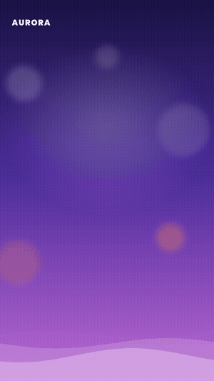
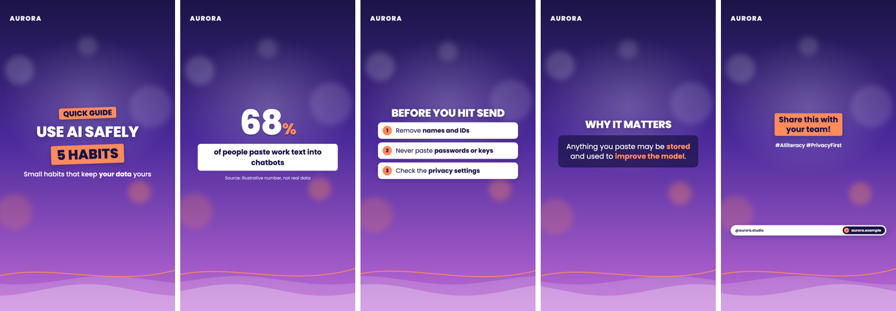
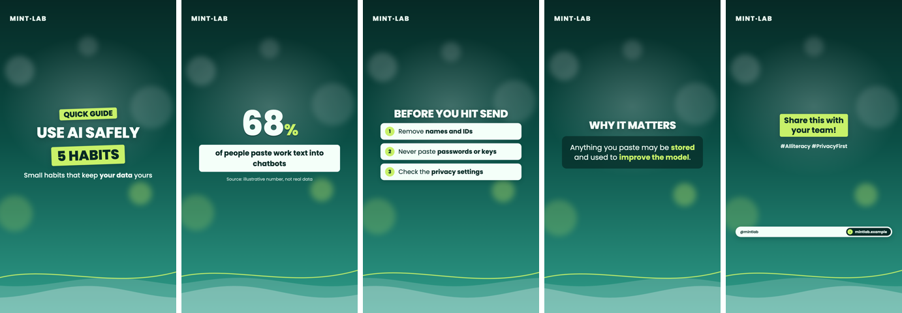

# tokens-to-motion

**Design tokens + a JSON script → 9:16 motion-graphic reels**, built with [Remotion](https://www.remotion.dev/). Write the content once and swap the theme file: colours, font, brand mark and motion feel all come from tokens.

<p align="center"></p>

| Same `motion.json`, theme `aurora` |
|---|
|  |
| **Same `motion.json`, theme `mint`** |
|  |

## Why

Social teams make the same kinds of reels over and over: an intro, a big number, a short list, a key point and a call to action. With this kit:
- **Content** is a small JSON file that a copywriter, or an AI agent, can write.
- **Brand** is a theme file that a designer owns.
- **Video** is a pure function of the two. A free still storyboard comes first, so everyone approves before the full render.

## How it works

```
examples/<reel>/motion.json  ──┐
themes/<name>.json  ───────────┼─► scripts/shared.mjs (validate, attach tokens, bundle once)
                               │        ├─► storyboard.mjs  → storyboard/<theme>/scene-NN.png  (one still per scene)
src/ (React + Remotion)  ──────┘        └─► render.mjs      → video/<reel>-<theme>_vN.mp4      (never overwrites)
```

- **5 scene types** (`src/kit/Scenes.tsx`): `intro` (optional photo rising from the bottom), `stat` (count-up number), `list` (staggered items), `point`, `outro` (brand footer).
- **Safe zone.** Everything sits between y 270 and y 1500, with 108 px side margins, so the platform's UI never covers it.
- **Theme context.** Each component reads colours, shadows, spring settings and crossfade length from the theme. No colour values are hard-coded in components.
- **Storyboard frames** are picked automatically at ~60 % of each scene: after the entrance animation, before the fade-out.
- `**bold**` in any text becomes emphasised words. Optional voice-over and music are referenced from the JSON.

## Usage

```bash
npm install
npm run storyboard -- examples/ai-tips              # stills, theme from motion.json
npm run storyboard -- examples/ai-tips --theme mint # same content, another brand
npm run render -- examples/ai-tips                  # MP4 1080×1920, 30 fps, h264
npm run studio                                      # live preview in Remotion Studio
npm run check                                       # type-check
```

### motion.json

```json
{
  "title": "5 habits for using AI chatbots safely",
  "theme": "aurora",
  "scenes": [
    { "type": "intro", "seconds": 4, "tag": "Quick guide", "title": "Use AI safely", "highlight": "5 habits" },
    { "type": "stat", "seconds": 4, "value": 68, "unit": "%", "label": "of people **paste work text**" },
    { "type": "list", "seconds": 5, "title": "Before you hit send", "items": ["Remove **names and IDs**"] },
    { "type": "outro", "seconds": 4, "text": "Share this with\n**your team**!", "tags": ["#AIliteracy"] }
  ]
}
```

Types are in `src/types.ts`. To add a brand, copy `themes/aurora.json` and change the tokens.

## License

MIT. Remotion itself has its own [license](https://www.remotion.dev/license) (free for individuals and small teams).
